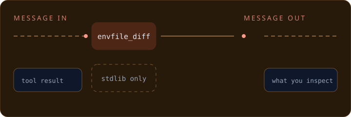

<p align="center">
  
</p>

<p align="center">
  <a href="https://pypi.org/project/envfile-diff/"></a>
  <a href="https://pypi.org/project/envfile-diff/"></a>
  <a href="https://pypi.org/project/envfile-diff/"></a>
  <a href="https://github.com/sandeshbagmare/envfile-diff/actions/workflows/ci.yml"></a>
  <a href="https://github.com/sandeshbagmare/envfile-diff/blob/main/LICENSE"></a>
  <a href="https://sandeshbagmare.github.io/envfile-diff/"></a>
  <a href="https://pypi.org/project/envfile-diff/"></a>
</p>

<h3 align="center">diff two .env files without printing the secrets</h3>
<p align="center"><em>Standard library only. No runtime dependencies. Python 3.9+.</em></p>

<p align="center">
  
</p>

## Install

```console
pip install envfile-diff
```

## Use

```console
envfile-diff old.env new.env                  # masked
envfile-diff old.env new.env --show-values    # the real values
envfile-diff old.env new.env --json           # {"added": [...], "removed": [...], ...}
envfile-diff old.env new.env --exit-code      # CI gate: exit 1 when they differ
```

```python
from envfile_diff import diff_env, diff_files, parse_env, render

diff = diff_files(".env.staging", ".env.production")
diff.is_empty
diff.added, diff.removed, diff.changed, diff.unchanged
for change in diff.changes():          # sorted by key
    print(change.key, change.kind)     # "added", "removed" or "changed"
print(render(diff, show_values=False))
```

## What the parser understands

- comments and blank lines, `export KEY=value`
- `KEY=` (empty), spaces around `=`
- `"double quoted"` values with `\n`, `\t`, `\r`, `\"`, `\\` escapes
- `'single quoted'` values, taken literally, `#` inside any quotes
- a trailing `# comment` after an unquoted value
- CRLF files, keys with dots or dashes (`DB.HOST`, `MY-KEY`)
- a repeated key keeps the last value, as a shell does

A line that is not an assignment raises `EnvParseError` with the line number instead
of being silently dropped — a typo in a `.env` file is exactly the kind of thing you
want to hear about.

## Values never leak by accident

Masking is the default in the function (`render(show_values=False)`), in the CLI and in
`--json`. Even with `--json` the payload holds key names only; `--json --show-values`
is the one combination that prints values.

## Development

```console
python -m venv .venv
.venv/bin/pip install -e ".[test]"
.venv/bin/pytest
```

## License

MIT.
